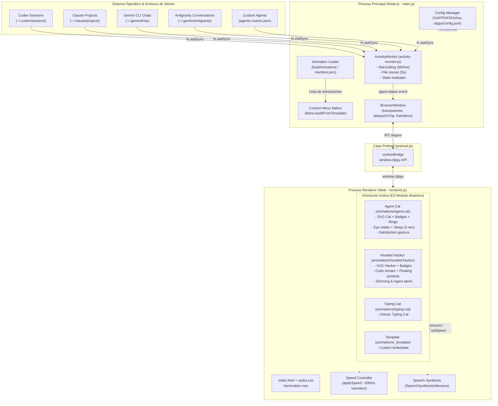

# Mapa del Proyecto: My Clippy

> **Versión del proyecto:** 1.0.0  
> **Tecnologías clave:** Electron, Node.js, JavaScript (ES6+ / CommonJS / ES Modules), SVG, CSS3  
> **Propósito:** Asistente de escritorio flotante, transparente y reactivo con animaciones modulares que reacciona a la actividad en tiempo real de agentes de Inteligencia Artificial (Codex, Claude Code, Gemini CLI, Antigravity y personalizados).

---

## 1. Diagrama de Arquitectura y Flujo de Comunicación

El proyecto sigue el modelo de aislamiento de procesos de Electron (**Main**, **Preload** con `contextIsolation`, y **Renderer**), comunicándose mediante eventos IPC asíncronos y desacoplados:



---

## 2. Desglose Estructural de Archivos y Módulos

```
my-clippy/
├── activity-monitor.js        # Motor genérico de monitoreo de agentes de IA
├── codex-monitor.js           # Monitor legacy específico de Codex (retrocompatibilidad)
├── codex-monitor.config.json  # Configuración legacy del monitor de Codex
├── main.js                    # Proceso principal de Electron (lifecycle, ventana, menú)
├── preload.js                 # Bridge de seguridad para exponer la API segura al renderer
├── renderer.js                # Orquestador del renderer (velocidad, voz, carga de animación)
├── index.html                 # Ventana HTML base (transparente, asistente y raíz de animación)
├── styles.css                 # Estilos globales de la ventana flotante
├── package.json               # Configuración de Electron, dependencias y scripts de empaquetado
├── phrases.json               # Banco de frases y chistes para síntesis de voz
├── simulate-agents.js         # Herramienta de pruebas para simular actividad de agentes
├── simulate-codex.js          # Herramienta de pruebas para simular sesiones de Codex
│
├── animations/                # Directorio modular de animaciones intercambiables
│   ├── README.md              # Documentación técnica para crear nuevas animaciones
│   │
│   ├── agent-cat/             # Animación: Gato naranja con insignias giratorias de IA
│   │   ├── manifest.json      # Metadatos (id: "agent-cat", tamaño 200x232)
│   │   ├── animation.js       # Lógica SVG, parpadeo centrado, estados y badges
│   │   └── style.css          # Anillos giratorios, keyframes, sudor, sueño
│   │
│   ├── hooded-hacker/         # Animación: Hacker encapuchado en terminal con insignias
│   │   ├── manifest.json      # Metadatos (id: "hooded-hacker", tamaño 220x262)
│   │   ├── animation.js       # Lógica SVG, escritura de código, símbolos y badges
│   │   └── style.css          # Animaciones CSS, terminal verde y atenuación
│   │
│   ├── typing-cat/            # Animación: Gato tecleando clásico
│   │   ├── manifest.json      # Metadatos (id: "typing-cat", tamaño 160x210)
│   │   ├── animation.js       # Lógica SVG clásica de gato tecleando
│   │   └── style.css          # Estilos y keyframes clásicos
│   │
│   └── _template/             # Plantilla para crear nuevas animaciones
│       ├── manifest.json      # Manifiesto plantilla
│       └── animation.js       # Implementación básica de contrato
│
├── build/                     # Recursos gráficos de compilación
│   └── icon.png               # Ícono de la aplicación (512x512)
│
└── docs/                      # Documentación para usuarios y desarrolladores
    ├── packaging-guide.md     # Guía paso a paso para compilar .exe en PowerShell
    └── project-map.md         # Mapa arquitectónico y estructural del proyecto
```

---

## 3. Módulos Principales y Responsabilidades

### 3.1. Núcleo de Aplicación (`main.js`)
- **Gestión de Ventana:** Inicializa `BrowserWindow` sin marco (`frame: false`), fondo transparente (`transparent: true`), fijado al frente (`alwaysOnTop: true`) y excluido de la barra de tareas (`skipTaskbar: true`).
- **Cargador de Animaciones (`loadAnimations`):** Lee `animations/` y la carpeta externa `%APPDATA%/my-clippy/animations/`. Valida cada `manifest.json`.
- **Menú Contextual Nativo (`showMenu`):**
  - Casilla *"React to AI agents"* (activa/desactiva el monitor).
  - Estado en vivo de agentes (*"Agents: Codex, Antigravity working"*).
  - Submenú *"Watch"* con agentes disponibles/no encontrados y opción *"Reload custom agents"*.
  - Selector de animaciones (*"Change animation"*).
  - Control de velocidad (*"Faster"*, *"Slower"*).
  - *"Start with Windows"* (vía `app.setLoginItemSettings`).
- **Persistencia de Configuración:** Guarda `activeAnimation`, `reactToAgents`, `startWithWindows` y estados de agentes en `%APPDATA%/my-clippy/config.json`.
- **Migración Automática:** Si el usuario tenía guardados los IDs en español (`gato-agentes`, `gato-tecleando`, `_plantilla`), se migran transparentemente a `agent-cat`, `typing-cat` y `_template`.

### 3.2. Motor de Monitoreo de IA (`activity-monitor.js`)
- **Monitoreo exclusivo de metadatos:** Emplea `fs.statSync` (`mtimeMs` y `size`) sobre un máximo de 20 archivos recientes por agente (modificados en las últimas 24 h). **Nunca lee el contenido** de los archivos.
- **Ciclo de tiempo:**
  - `tick()` cada 500 ms: verifica si cambió `mtime` o tamaño en los archivos candidatos.
  - `scan()` cada 5 s: redescubre archivos candidatos recientes recorriendo directorios con profundidad limitada.
- **Tolerancia a fallos:** Rutas inexistentes o inaccesibles se ignoran con un único aviso por consola sin bloquear el motor ni otros agentes.
- **Registro integrado (`BUILTIN_AGENTS`):**
  1. **Codex:** `${CODEX_HOME:-~/.codex}/sessions` (umbral: 3 s, badge `Cx`, color `#1D9E75`, anillo `segments`).
  2. **Claude Code:** `${CLAUDE_CONFIG_DIR:-~/.claude}/projects` (umbral: 6 s, badge `Cl`, color `#D85A30`, anillo `dots`).
  3. **Gemini CLI:** `~/.gemini/tmp/**/chats` (umbral: 8 s, badge `Ge`, color `#378ADD`, anillo `double-arc`).
  4. **Antigravity:** `~/.gemini/antigravity/conversations` y `brain` (umbral: 8 s, badge `Ag`, color `#7F77DD`, anillo `arc`).
- **Agentes Personalizados (`agents.custom.json`):**
  - Ubicado en `%APPDATA%/my-clippy/agents.custom.json`.
  - Soporta expansión de variables (`~`, `%VAR%`, `$VAR`, `${VAR:-def}`).
  - Asignación visual automática: genera monogramas de 2 o 3 letras con resolución de colisiones y asigna color y anillo sin repetición de paletas predefinidas.

### 3.3. Orquestador Renderer (`renderer.js`)
- **Contenedor Dinámico:** Carga dinámicamente el módulo JS (`import(manifest.entryUrl)`) y hoja de estilos de la animación elegida.
- **Interpolación de Velocidad (`applySpeed`):**
  - Calcula la velocidad efectiva: `velocidadBase * multiplicadorEstado`.
  - Multiplicadores: `idle` = 1x, `working` = 2.5x, `intense` = 4x.
  - Interpola la variable CSS `--speed` durante ~300 ms mediante `requestAnimationFrame`.
- **Síntesis de Voz (`say`):** Utiliza la API nativa `speechSynthesis`. Pausa el tecleo de la animación activa durante el habla y reanuda la velocidad al terminar.

### 3.4. Animación con Insignias (`animations/agent-cat/`)
- **Diseño SVG:** Ilustración vectorial en `viewBox="0 0 200 232"` (gato naranja con rayas en la frente, patas sobre el teclado, código multicolor en la laptop y cola curva).
- **Parpadeo Centrado:** Cada ojo (`.ac-eye-item`) está centrado en su eje individual ($Y = 68\text{ px}$), evitando saltos o desplazamientos verticales al escalar.
- **Insignias Dinámicas:** Círculos de 28 px con texto contrastado y anillos giratorios SVG (`arc`, `dots`, `double-arc`, `segments`). Muestra hasta 4 insignias; la 5ª se convierte en insignia acumulativa `+N`. Al hacer clic sobre una insignia, el gato dice quién está trabajando.
- **Máquina de Estados Visuales:**
  - **Reposo (0 agentes):** Ojos entrecerrados relajados (`scaleY(.75)`), pestañeo lento (~5.2 s).
  - **Sueño (3 min sin trabajo):** Ojos cerrados fijos (`scaleY(.06)`), texto flotante "z Z", patas detenidas.
  - **Trabajando (1-2 agentes):** Ojos abiertos alertas, tecleo a velocidad media, partículas de código.
  - **Intenso (3+ agentes):** Cejas fruncidas, gota de sudor, patas aceleradas.
  - **Satisfacción:** Sonrisa y guiño del ojo derecho durante 1.5 s al pasar de trabajo a reposo.

### 3.5. Animación Hacker Encapuchado (`animations/hooded-hacker/`)
- **Diseño SVG:** Figura en perspectiva 3/4 mirando a la izquierda hacia la pantalla (`viewBox="0 0 220 262"`). Rostro en completa sombra dentro de la capucha (`#0E1013`), sin máscara ni rostro visible. Laptop con pantalla orientada al usuario y teclado en perspectiva.
- **Líneas de Código y Símbolos Flotantes:** Seis líneas de código estilizadas con efecto de escritura continua escalonada (`stroke-dasharray`), cursor parpadeante y símbolos de terminal (`01`, `>_`) que flotan hacia arriba.
- **Mecanismo de Atenuación e Inactividad:** Tras 3 minutos sin actividad de agentes, la pantalla atenúa su brillo al 35% y las manos detienen el tecleo. Cualquier actividad restaura instantáneamente la intensidad.
- **Insignias y Reacciones:** Soporte completo para insignias giratorias de agentes (`arc`, `dots`, `double-arc`, `segments`) con síntesis de voz en inglés al hacer clic.

---

## 4. Flujo de Datos y Eventos IPC

| Canal / Método IPC | Tipo | Origen $\rightarrow$ Destino | Descripción |
| :--- | :--- | :--- | :--- |
| `agent-status` | Send | Main $\rightarrow$ Renderer | Emite `{ status, active, details }` cuando cambia el estado global o las herramientas activas. |
| `change-animation` | Send | Main $\rightarrow$ Renderer | Notifica el manifiesto de la nueva animación seleccionada en el menú. |
| `menu-action` | Send | Main $\rightarrow$ Renderer | Envía comandos de velocidad (`'speed'`, factor `1.25` o `0.8`). |
| `show-context-menu` | Send | Renderer $\rightarrow$ Main | Solicita desplegar el menú contextual al hacer clic derecho. |
| `start-drag` / `move-drag` / `end-drag` | Send | Renderer $\rightarrow$ Main | Coordina el arrastre manual de la ventana sin interferir con eventos de clic. |
| `get-agent-status` | Invoke/Handle | Renderer $\rightarrow$ Main | Obtiene el estado actual de los agentes al cargar el DOM. |
| `list-animations` | Invoke/Handle | Renderer $\rightarrow$ Main | Retorna la lista completa de animaciones cargadas. |
| `get-active-animation` | Invoke/Handle | Renderer $\rightarrow$ Main | Obtiene el manifiesto de la animación activa inicial. |

---

## 5. Scripts de NPM y Herramientas

| Script | Comando | Descripción |
| :--- | :--- | :--- |
| `npm start` | `set ELECTRON_RUN_AS_NODE=&& electron .` | Inicia My Clippy en modo desarrollo. |
| `npm run build:dir` | `electron-builder --win --dir` | Genera la carpeta desempaquetada en `dist/win-unpacked/` para pruebas rápidas. |
| `npm run build` | `electron-builder --win` | Genera el instalador NSIS y la versión portable en `dist/`. |
| `npm run simulate-agents [opción]` | `node simulate-agents.js` | Modifica archivos temporales durante 15 s para probar el detector (`1`, `3`, `4`, `custom`, `all` o ID). |
| `npm run simulate-codex` | `node simulate-codex.js` | Simula escritura en un archivo temporal de Codex durante 10 s. |

---

## 6. Directorios de Datos del Usuario (`userData`)

En Windows, los datos en ejecución y configuraciones se almacenan en:
`%APPDATA%\my-clippy\` (típicamente `C:\Users\<Usuario>\AppData\Roaming\my-clippy\`)

- **`config.json`**: Preferencias del usuario (animación activa, arranque con Windows, casillas de agentes).
- **`agents.custom.json`**: Registro de agentes de IA definidos por el usuario.
- **`animations/`**: Directorio donde el usuario puede colocar carpetas de animaciones externas sin recompilar la app.
- **`logs/error.log`**: Bitácora de errores no controlados.


